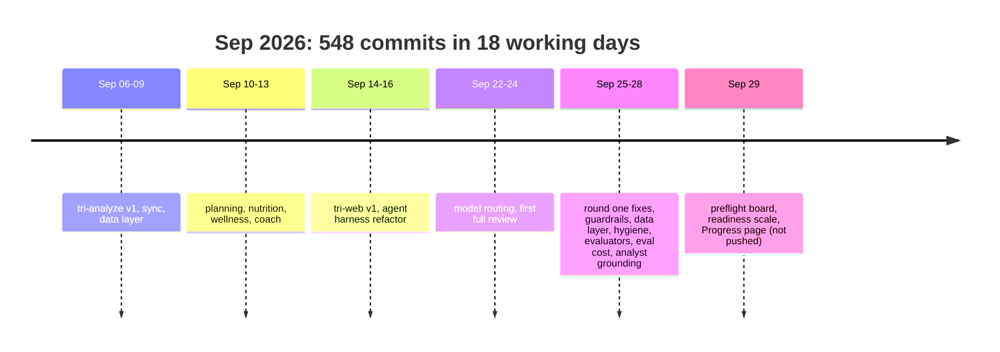
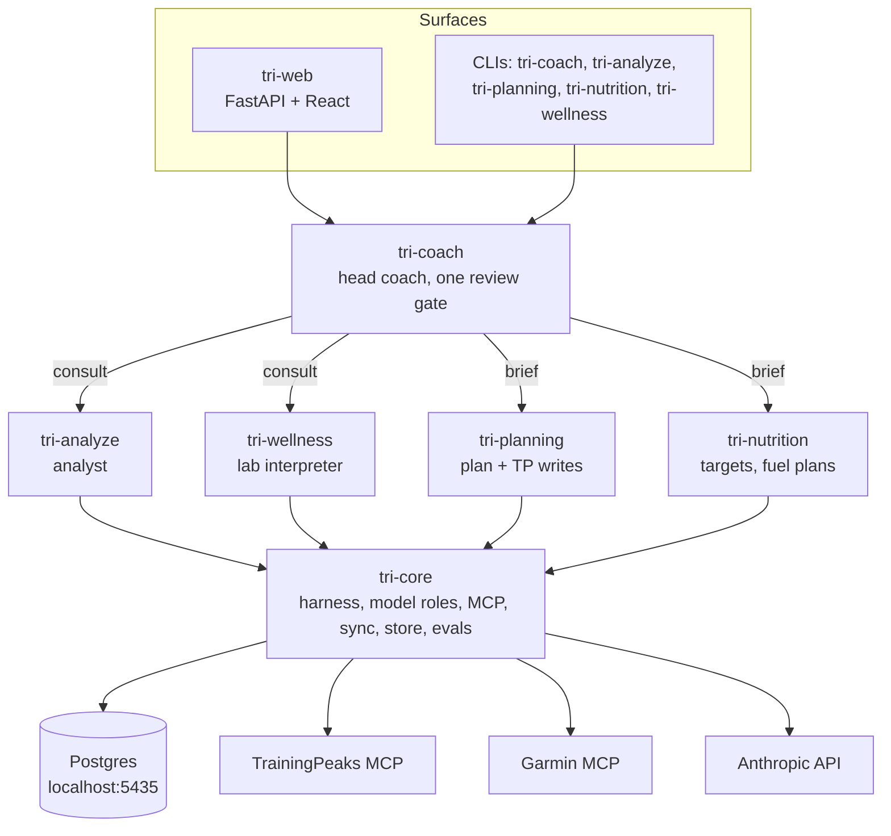

# Codebase review, 2026-10-17

Main @ `123ab0e` (2026-09-29). Second full review, 18 days after the last commit. It covers where the work stopped, what works, what does not, and what to do next. **Verified** means I ran it or read the code path. **Evidence** means a grep, merge message or doc points that way, but I did not trace the path.

## Bottom line

- The codebase is in good health. Every check passes locally: 1,513 Python tests, 150 Vitest tests, 5 Playwright tests, ruff, ruff format, mypy strict, ESLint and the production build. Zero `TODO`/`FIXME` markers.
- Round one is done. Almost every issue from the 2026-09-24 review was fixed and merged between Sep 25 and Sep 28.
- The work stopped on the web track. The Progress page was finished and reviewed on Sep 29, then merged into local `main`. **35 commits are not pushed**, so CI has never run on them.
- Round two (features, optimizations, test gaps) is specced but has no plans and no code.
- The biggest open product risk is analyst accuracy: `grounded` passes 6 of 12 eval cases.
- The biggest open technical debt is blocking database calls inside async web handlers. The new Progress endpoint repeats that pattern.

## Where we left off

Three tracks, three states:

| Track | State | Evidence |
|---|---|---|
| Round one (correctness, data layer, guardrails, hygiene, evaluators, eval cost, analyst grounding) | **Shipped and pushed.** | Merges `b14a0bc` to `3c11c15`, all on `origin/main`; CI green on each. |
| Round two (`2026-09-28-features-design.md`, `-optimizations-design.md`, `-test-gaps-design.md`) | **Specced only.** No plan files, no code. The per-cell SQL cap (optimizations §4.1, `CELL_MAX_CHARS`) is not built either; only round one's whole-result cap exists (`sql_tool.py:93`). | `ls docs/superpowers/plans`; grep for `CELL_MAX_CHARS`, fuel fingerprint, sync gather, turn ids, `weekly`, per-sport TSS: no hits. |
| Web (preflight board, readiness scale, Progress page) | **Shipped locally, not pushed.** Nutrition and Labs pages are still placeholders. | `git log origin/main..main` = 35 commits; `web/src/router.tsx`. |

Evals still owed, from `docs/notes/2026-09-28-anthropic-api-usage-audit.md`:

- `tri-planning eval` (design-v2, 23 cases), after the evaluators merge.
- `tri-coach eval` (coach-v4, 13 cases), the guardrails-02 comparison.

## Getting back in

1. **Push.** Run `git push origin main` yourself. CI then runs on the 35 new commits for the first time. Locally they all pass (see Health check).
2. **Delete merged branches** after you confirm: `feat/progress-page` and `docs/architecture-map` are both fully merged into `main`.
3. **Clean untracked files.** The root `node_modules/` is empty; delete it. Either commit `.impeccable/` or add it to `.gitignore`. Recommendation: gitignore it, because it holds tool cache (`hook.cache.json`) next to design state that `DESIGN.md` already records.
4. **Re-auth the MCP servers before the first sync.** The data is 20 days old (last sync 2026-09-27). The TrainingPeaks browser cookie has probably expired; Garmin tokens may have too. Use the commands in README step 4, then `uv run tri sync`.
5. **Postgres container.** I started `tri-analyze-db` (`docker compose up -d`, localhost:5435) to run the DB tests. It is still running; stop it with `docker compose stop`.

## How it fits together

The layering holds: the four specialist packages depend only on `tri-core`, and `tri-coach` is the only package above them. Every write to TrainingPeaks or Garmin goes through the coach's review gate.

| Package | Src lines | Test lines |
|---|---:|---:|
| tri-core | 3,855 | 4,373 |
| tri-analyze | 2,399 | 2,276 |
| tri-planning | 3,972 | 4,341 |
| tri-nutrition | 5,192 | 4,532 |
| tri-wellness | 3,749 | 3,569 |
| tri-coach | 3,624 | 4,483 |
| tri-web | 2,298 | 2,501 |
| web/ (React) | 4,269 | 2,133 |

## Health check, run 2026-10-17

Run twice, with the same results both times. The second run was after Docker came back, with `tri-analyze-db` healthy and both databases migrated.

| Check | Result |
|---|---|
| `uv run pytest -q -rs` (Postgres up) | **1,513 passed, 6 skipped.** All 6 skips are `needs --live`, which is what CI requires. |
| `uv run ruff check .` / `ruff format --check .` | Pass / 409 files formatted. |
| `uv run mypy` (strict, 234 files) | Pass. |
| `npm run lint` / `npm test` / `npm run build` | Pass / 150 tests in 22 files / builds, with a 573 kB chunk warning. |
| `npm run test:e2e` | 5 passed. |
| CI on GitHub | Last 5 runs green, the latest at `4fa5b1d` (Sep 29). The 35 newer commits have not run in CI. |

Without Postgres, 399 tests skip silently. CI catches this; a local run does not.

## What works

- **Clear structure.** A uv workspace with one-way dependencies and a shared agent harness (`tri_core.harness`). Each package has its own CLI, README and architecture page.
- **A safety model that the code enforces.** These were all prose or missing on Sep 24; now they are code:
  - Python owns TSS (`tri_planning/planning/tss.py`). The model no longer does the arithmetic.
  - Validate-then-refuse: a plan or fuel note with violations is not proposed, and `check-in --yes` exits 1.
  - Record-before-write with reconciliation, in planning and nutrition (`reconcile_pending` in both `apply.py` files).
  - A consult budget per domain (`tri_coach_max_consults_per_domain`, `consults_left` in the coach context).
  - One held-review rule. The web route checks for a paused review (`routes/coach.py:38`).
  - Embedded sub-graphs compile with `checkpointer=False` (`harness/agents.py:60`).
  - The SQL tool runs as a read-only `tri_reader` role (migration 010) with an 8,000-character result cap.
  - MCP subprocesses get a minimal environment (`mcp/env.py`), not the full `os.environ`.
- **A data layer the agents can trust.** The sync window reaches 28 days ahead. Deleted TrainingPeaks workouts are tombstoned (`runner.py:86-90`). Garmin activities are stored per workout, so bricks keep both legs.
- **Correct lab handling** (verified). Reference ranges are converted with the value (`normalize.py:106-107`), and `<`/`>` bounds reach `Finding` (`labs/models.py:87`).
- **Tests and types.** Test lines roughly equal source lines in every Python package. mypy strict, TypeScript strict and CI all run, and CI fails on any unexpected skip.
- **Eval infrastructure with cost control.** Per-role usage and $ cost, `--rescore`, `--cases`, `--failed-from`, a `gate: false` flag on subsets, local runs, and a project rule to ask before any paid run.
- **Process.** 22 specs, 42 plans, architecture pages and dated notes. Every feature on record went spec, then plan, then branch, then merge.
- **The web app.** The preflight board gives a go/easy/rest call from the athlete's own numbers. The Progress page has the PMC, ramp rates, weekly volume and sport share. Both have phone-width e2e checks and a recorded design system (`DESIGN.md`).

## What does not work, or is at risk

Ranked by impact on the athlete.

| # | Issue | Where | Status |
|---|---|---|---|
| 1 | **Analyst accuracy.** `grounded` passes 6/12. Remaining failures: arithmetic outside SQL, window dates no query returned, invented cutoffs ("readiness under ~55"), a misread column (132 bpm given as 132 W), a wrong zone label. The coach's answers rest on this agent. | `docs/notes/2026-09-28-analyst-grounding-runs.md` | Verified (from the note) |
| 2 | **Blocking DB calls in async handlers.** `build_today` and `build_progress` open a sync psycopg connection inside `async def` and run about 20 queries. A Today refetch stalls the coach's SSE stream. Flagged on Sep 24 and in the optimizations spec §4.6; the new Progress code repeated it. | `tri_web/today.py:281`, `tri_web/progress.py:190` | Verified |
| 3 | **Unpushed, un-CI'd work.** 35 commits, three features. One disk failure loses them. | `git log origin/main..main` | Verified |
| 4 | **The coach thread grows forever.** Every turn resends the whole history, so cost and latency rise with use. No trimming or summarising exists in tri-coach or the harness. | `tri-coach`, `tri_core/harness` (no trim/summary code) | Evidence |
| 5 | **Stale data, fragile auth.** Last sync 2026-09-27. Both MCP servers are third-party, git-pinned and depend on a browser cookie (TP) or a login token (Garmin). Breakage shows up as a sync failure, not a clear auth error. | `sync_state` table; README step 4 | Verified (dates) |
| 6 | **e2e does not test the backend.** Both Playwright specs stub every `/api` route, and CI does not run e2e at all. | `web/tests/e2e/*.spec.ts`, `.github/workflows/ci.yml` | Verified |
| 7 | **Docs say "Draft" for shipped work.** For example, `guardrails`, `hygiene`, `evaluators`, `correctness-fixes` and `analyst-grounding` specs all say Draft, but were merged. Only the first three tri-planning plans have ticked boxes; the other 39 have none. A new reader (or a new session) cannot tell what shipped. | `docs/superpowers/specs/*`, `plans/*` | Verified |
| 8 | **No cost baseline for evals.** The four `.evals/*.jsonl` files predate the `usage` key, so the project rule's "latest full run's `usage.total_cost`" has nothing to read. | `.evals/` | Verified |
| 9 | **One JS chunk of 573 kB.** Every page loads `react-markdown` and all chart code up front. | `npm run build` output | Verified |
| 10 | **Minor.** Root `node_modules/` (empty) and `.impeccable/` untracked. LangSmith uses `ast.Str`, which Python 3.14 removes; the project pins `<3.13`, so no impact today. | repo root | Verified |

## Areas for improvement

### Do next (small, high value)

1. **Push, then let CI run.** No code change.
2. **Make the web handlers non-blocking.** Wrap the sync DB sections of `build_today` and `build_progress` in `await asyncio.to_thread(...)`, or move them to an async psycopg pool. This is the optimizations spec §4.6 for two files. Look up the psycopg and FastAPI docs for the versions in `uv.lock` first.
3. **Fix the doc status lines.** One commit: set each shipped spec to "Implemented (merge `<sha>`)". Stop using checkboxes in plans, or tick them at merge.
4. **Record a cost baseline.** The next paid full run per eval writes `usage.total_cost`, and the rule then works.

### Then (round two, already specced)

5. **Write the plans for round two** in this order:
   - **Optimizations first.** Coach thread bound and cacheable prefix (§4.4), parallel sync (§4.3), fuel fingerprint (§4.2). Cost and latency gains on every turn.
   - **Test gaps second.** Judge calibration against labels (§4.1) matters before any more prompt tuning on `grounded`. A real-backend e2e (§4.4) closes risk #6.
   - **Features third.** C3 (resumable turns, ask-while-paused) and C4a (weekly and race readiness) carry the most daily value. C1, C2 and C4b can wait.
6. **Analyst grounding, round two.** The failures left are SQL discipline (compute in SQL, state the window from the query) and invented thresholds. Calibrate the judge first (item 5), so the next prompt change is measured against a judge you trust.

### Later (product)

7. **Nutrition and Labs pages.** The backends exist. These are the two placeholders in the app.
8. **Code splitting.** Lazy-load the Progress route and `react-markdown`.
9. **A clear auth-expired state.** Show "TrainingPeaks login expired: run `tp-mcp auth`" in the app instead of a generic sync error.

## Eval runs these steps would need

Each run needs Brian's approval before it starts (project `CLAUDE.md`). No `.evals` file has `usage.total_cost`, so every estimate below is "no baseline"; the audit note's figure is about $1 per full run.

| Purpose | Command | Cases | Estimate |
|---|---|---:|---|
| Owed: design-v2 gate | `uv run tri-planning eval` | 23 | no baseline (~$1 per audit note) |
| Owed: coach-v4 comparison | `uv run tri-coach eval` | 13 | no baseline (~$1 per audit note) |
| Analyst prompt iteration | `uv run tri-analyze eval --failed-from .evals/analyst-v3-judge2-local-00e7585f.jsonl` | 6 | no baseline (a fraction of a full run) |
| Judge-only change | `uv run tri-analyze eval --rescore .evals/<file>.jsonl` | 12 | no baseline (judge calls only) |

## Open questions

| Question | Recommendation | Why |
|---|---|---|
| Round two order: optimizations, test gaps or features first? | Optimizations, then test gaps, then features. | Optimizations cut the cost of every later turn and eval; calibration must come before more grounding work. |
| Run the two owed evals now? | Yes, but after the push and with your approval (~$2 total). | They gate merged work and give the first `usage.total_cost` baselines. |
| Build Nutrition/Labs pages or round two first? | Round two optimizations first, then Nutrition. | The coach thread bound and the async fix affect every page; Nutrition is the most-used of the two placeholders. |
| Keep the coach and analyst on the current models? | Keep them until judge calibration is done. | A model comparison is only meaningful against a calibrated judge. |
| Run Playwright in CI? | Yes, add `npx playwright install --with-deps chromium && npm run test:e2e` to the web job. | The specs run in about 5 s; they only protect the UI if CI runs them. |

## Appendix: the 2026-09-24 "fix first" list today

| # | Item | Now |
|---|---|---|
| 1 | Lab reference range not unit-converted | Fixed, verified (`normalize.py:106-107`) |
| 2 | `<`/`>` bounds lost | Fixed, verified (`bound` on `Finding`) |
| 3 | Brick energy double-counted | Fixed, evidence (`energy.py:48-51`) |
| 4 | Invalid fuel/plan still proposed and `--yes` approved | Fixed, evidence (merge `d9ca6b0`, validate-then-refuse) |
| 5 | Embedded graphs checkpoint to Postgres | Fixed, evidence (`checkpointer=False`) |
| 6 | Web chat during a paused review drops it | Fixed, evidence (`routes/coach.py:38`) |
| 7 | No future sync, no deletions | Fixed, evidence (`SYNC_AHEAD_DAYS = 28`, tombstones) |
| 8 | Bought-plan reject loops to review | Fixed, evidence (merge `146a2a1`); its test is still in the test-gaps spec §4.2 |
| 9 | Weekly TSS baseline divides by 4 | Fixed, verified (`tri_planning/repo.py:342` counts days with data) |
| 10 | Bricks never match | Fixed, evidence (Garmin activities per workout, merge `a850c94`) |
| 11 | MCP subprocess leak on failed connect | Fixed, evidence (`client.py`, `except BaseException` → `aclose`) |
| 12 | Forced sodium on short sessions | Fixed, verified (`nutrition/models.py:151`, `sodium_mg_per_h` now `ge=0`) |
